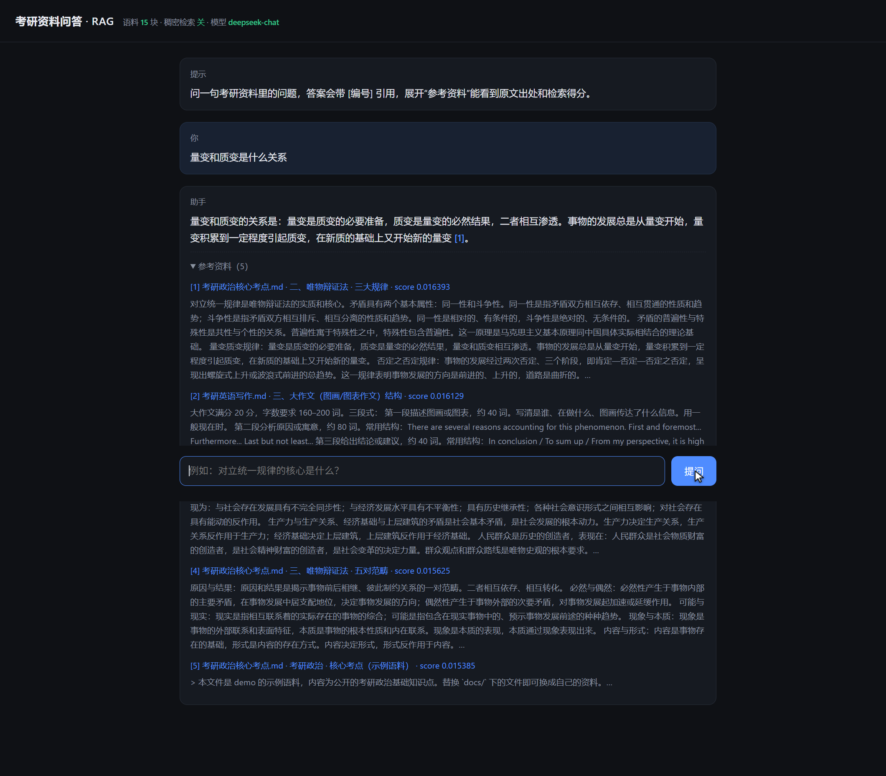

# kaoyan-rag · 考研资料问答（RAG Demo）

把考研资料（Markdown / 纯文本）切片、建索引，用**混合检索**找回相关段落，交给 DeepSeek 生成**带引用编号**的回答。回答里每个结论都能点开看到原文出处。

> 痛点：考研资料散在十几份文档里，查一个概念要来回翻页。而且通用模型答考研题容易编——所以要做的是「能指出出处」的问答。



回答里每个 `[编号]` 对应下面「参考资料」里的一段，展开能看到原文和检索得分。

## 架构

```
docs/*.md ──► 切片（按标题分节 + 段落合并，400 字/块，重叠 80 字）
                 │
                 ├──► BM25（中文二元组，稀疏检索）
                 └──► bge-m3 向量（可选，稠密检索）
                          │
                     RRF 融合排序 ──► top-k
                                       │
                              DeepSeek 生成（System Prompt 强制 [编号] 引用）
                                       │
                              SSE 流式推给网页
```

| 模块 | 文件 | 说明 |
|---|---|---|
| 切片 | `rag/loader.py` | 一级标题当文档名，二级标题当章节路径；段落合并到 400 字，块间重叠 80 字 |
| 检索 | `rag/index.py` | 自己实现的 BM25（中文二元组分词）+ 可选向量，两路结果用 RRF 融合（k=60） |
| 生成 | `rag/llm.py` | 直接打 DeepSeek 的 OpenAI 兼容 HTTP 接口，手写 SSE 解析，流式输出 |
| 编排 | `rag/pipeline.py` | 检索 → 拼上下文 → 流式生成 |
| 服务 | `server.py` | 标准库 `ThreadingHTTPServer`，`/api/ask` 用 SSE 推流 |
| 页面 | `web/index.html` | 单页聊天界面，展示引用片段和检索得分 |
| 评测 | `scripts/evaluate.py` | 10 道题的 Hit@k |

**零第三方依赖**，只用 Python 3.11+ 标准库。不用 pip 装任何东西。

## 快速开始

```powershell
cd E:\deepseek\kaoyan-rag
python -m scripts.build_index        # 建索引（BM25，秒级）
python server.py                     # 起服务，默认 http://127.0.0.1:8000
```

双击 `启动.bat` 也行。

生成回答需要一个 DeepSeek key，写在项目根目录 `.env`：

```
DEEPSEEK_API_KEY=sk-xxxx
# 可选：配了才开向量检索
SILICONFLOW_API_KEY=sk-xxxx
CHAT_MODEL=deepseek-chat
TOP_K=5
```

没有 key 时页面照常能开，检索结果照常显示，只是不生成回答——可以单独验检索质量。

## 评测

```powershell
python -m scripts.evaluate --k 3
```

当前结果：`Hit@3 = 10/10`。**注意这个数说明指标太松**——语料只有 15 块、问题是我按语料写的，几乎不存在干扰项。真实资料（几十万字）下这个指标会掉下来，才有参考价值。

## 换语料

把 `.md` / `.txt` 丢进 `docs/`，重跑 `build_index`。现在 `docs/` 里是示例语料（考研政治核心考点、英语写作要点）。

## 已知边界（面试会被问，先想好）

- **只有单轮问答**，追问指代会丢上下文（没做 query 改写）。
- **切片按标题和段落切**，没做语义切分，跨节的连续论述会被切断。
- **向量检索依赖外部 embedding 接口**，没配 key 时退化为纯 BM25。
- **没有幻觉检测**，只靠 Prompt 约束 + 引用编号，复杂问题仍可能答偏或引用错。
- 索引全量放内存，语料上万块要换真正的向量库（FAISS / Qdrant）。
